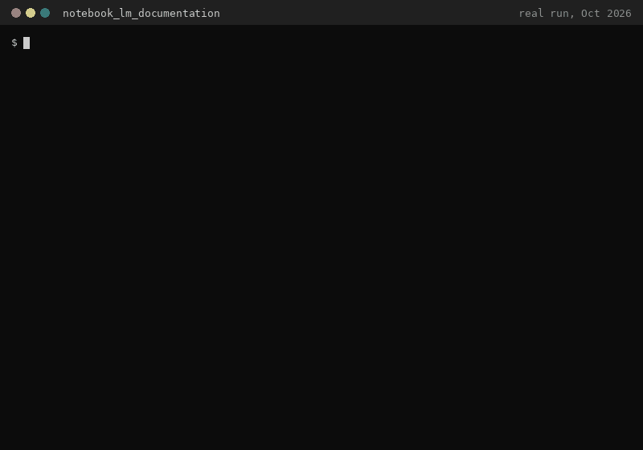

# NotebookLM Documentation Scraper

**Turn the whole NotebookLM (now "Gemini Notebook") Help Center into one Markdown file you can read offline or paste into an LLM as context.**



<sub>Real run against the public Help Center, Oct 2026.</sub>

## Why

Help-center docs are split across dozens of pages with collapsible sections, which makes them awkward to search, diff or feed to an AI assistant. One `python app.py` gives you a single, current Markdown file.

## Quick start

Requires Python 3 and Google Chrome or Chromium (Selenium 4 finds the matching driver).

```bash
git clone https://github.com/kamilkaczmareksolutions/notebook_lm_documentation.git
cd notebook_lm_documentation
pip install -r requirements.txt
python app.py        # writes notebook_lm_documentation.md
```

## How it works

1. Opens `support.google.com/notebooklm` in headless Chrome (Selenium).
2. Expands every top-level section and collects the article links.
3. Opens each article, clicks open all collapsible `h3` blocks, and parses the `<article>` HTML with BeautifulSoup.
4. Converts `h1`-`h3`, paragraphs and (nested) lists to Markdown and writes everything to `notebook_lm_documentation.md`, grouped by section.

## Limitations

- Relies on the current Help Center markup (`section.parent h3[role='button']`, `a.article-link`, `<article>`). If Google changes it, the selectors need updating.
- Fixed sleeps between page loads; a full run takes a few minutes.
- Some list items can appear twice in the output (once as a list item, once as its paragraph).
- The `notebook_lm_documentation.md` committed in this repo is an older snapshot; run the script for the current version.
- Unofficial tool for personal and educational use; the content belongs to Google.

## License

No license file yet.
